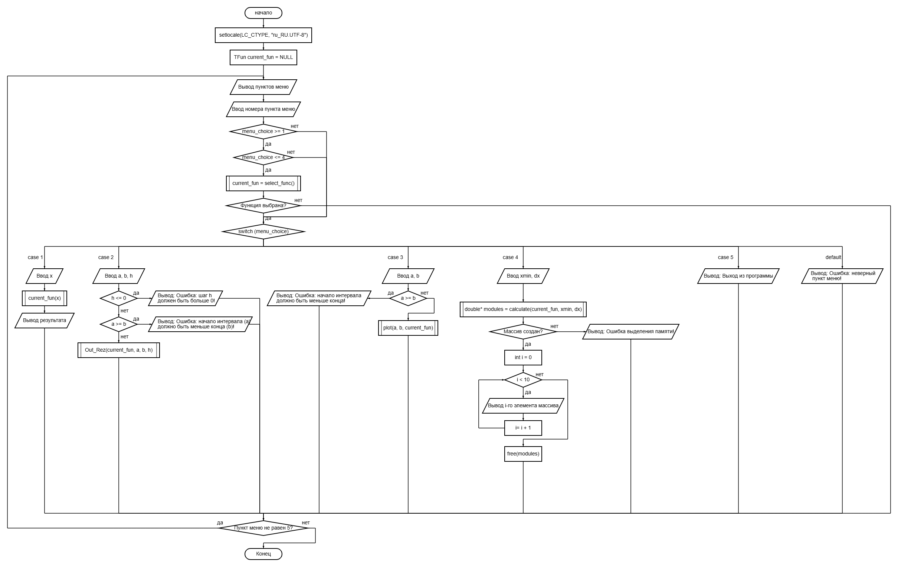
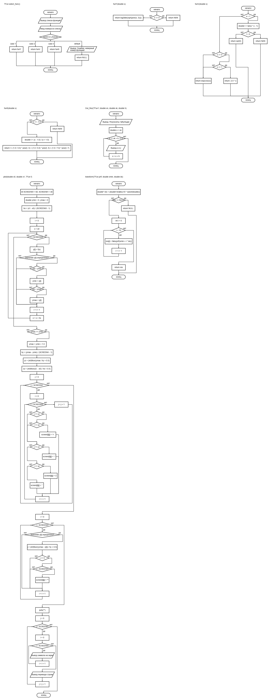
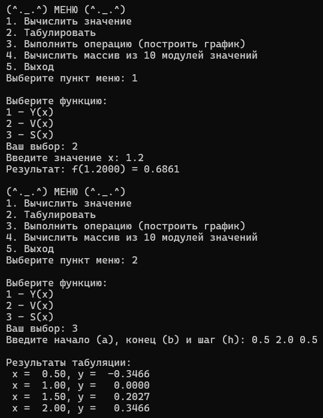
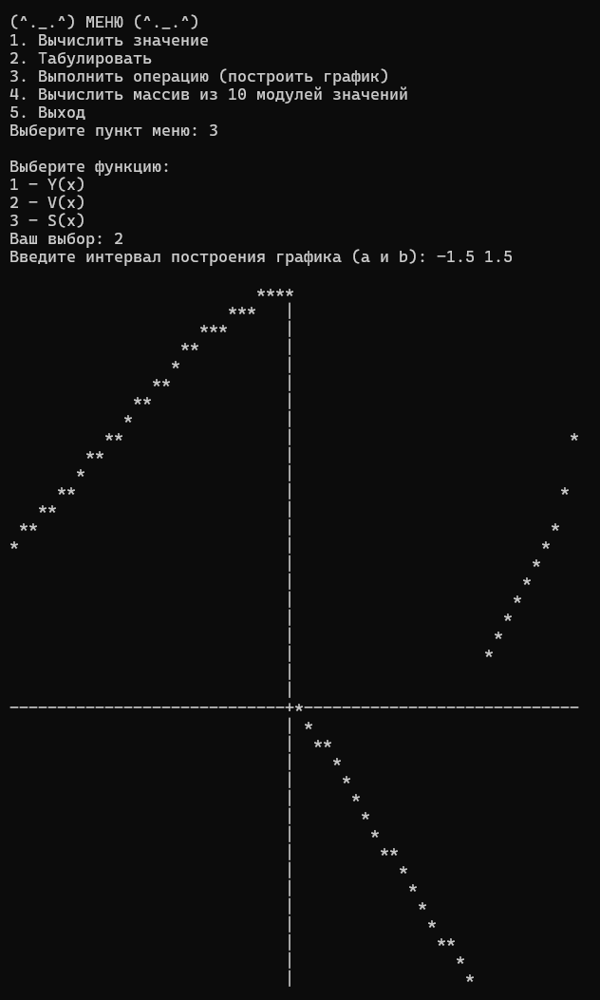
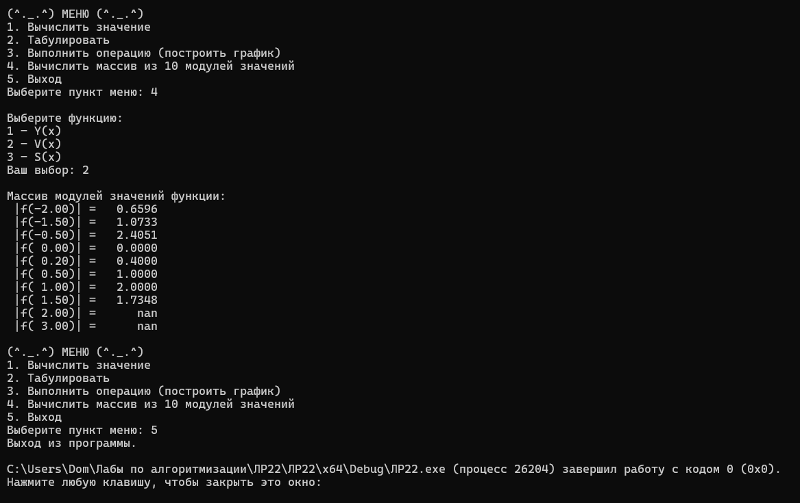

# Лабораторная работа 22

## Цель работы
Закрепление навыков передачи параметров по указателю в функции

## Блок-схема

## Результаты работы программы

## Информация о разработчике
Орлова Эльвира Эдуардовна
Группа: бИД-261
